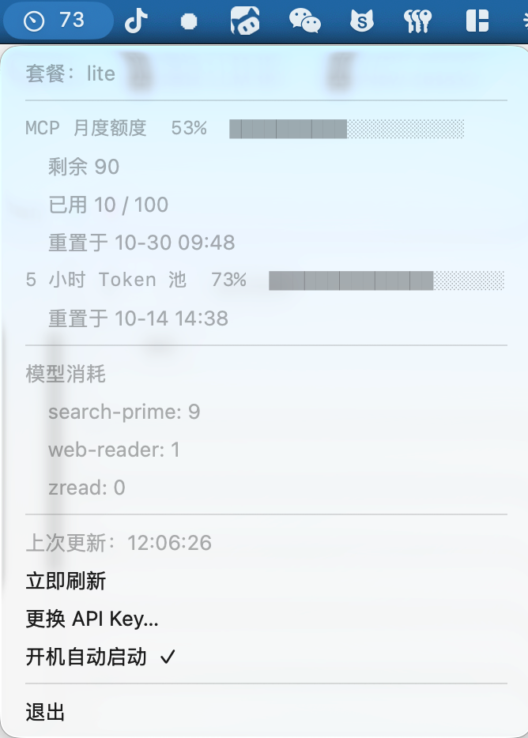

# GLM Usage Bar

macOS 菜单栏小工具，实时显示智谱 **GLM Coding Plan** 的用量（5 小时 Token 池、每周额度、MCP 月度额度）。产品需求见 [PRD.md](PRD.md)。



## 查询接口

```
GET https://open.bigmodel.cn/api/monitor/usage/quota/limit   # 国内站（智谱）
GET https://api.z.ai/api/monitor/usage/quota/limit           # 国际站 z.ai
Authorization: <你的 API Key>
```

## 构建

```bash
swift build -c release          # 产物 .build/release/GlmUsageBar
./scripts/build-app.sh          # 产物 dist/GlmUsageBar.app
./scripts/build-dmg.sh          # 产物 dist/GlmUsageBar.dmg（拖到 Applications 安装）
```

## 运行

```bash
# 方式一：直接运行（终端启动）
./.build/release/GlmUsageBar

# 方式二：App 包
open dist/GlmUsageBar.app
```

首次启动菜单栏没有 API Key，点菜单「设置 API Key…」输入即可；
Key 保存在 `~/.config/glm-usage-bar/config.json`（权限 600）。
也可以用环境变量 `ZHIPU_API_KEY` 提供。

## 菜单栏显示

- `GLM 62%`：当前最吃紧的一项额度使用百分比，颜色随用量变化（绿 / 橙 / 红）
- 下拉菜单：各额度进度条、剩余量、重置时间、分模型消耗
- 默认每 5 分钟自动刷新，可手动「立即刷新」

## 命令行调试

```bash
ZHIPU_API_KEY=你的key ./.build/release/GlmUsageBar --print
```

输出各额度原始数据，用于排查接口问题。

## 配置文件

`~/.config/glm-usage-bar/config.json`

```json
{
  "apiKey" : "你的 API Key",
  "endpoint" : "https://open.bigmodel.cn",
  "refreshIntervalSeconds" : 300
}
```

用 z.ai 国际站时把 `endpoint` 改为 `https://api.z.ai`。

## 安装到菜单栏 / 开机自启

把 `dist/GlmUsageBar.app` 拖到 `Applications`，启动后菜单里勾选「开机自动启动」。
